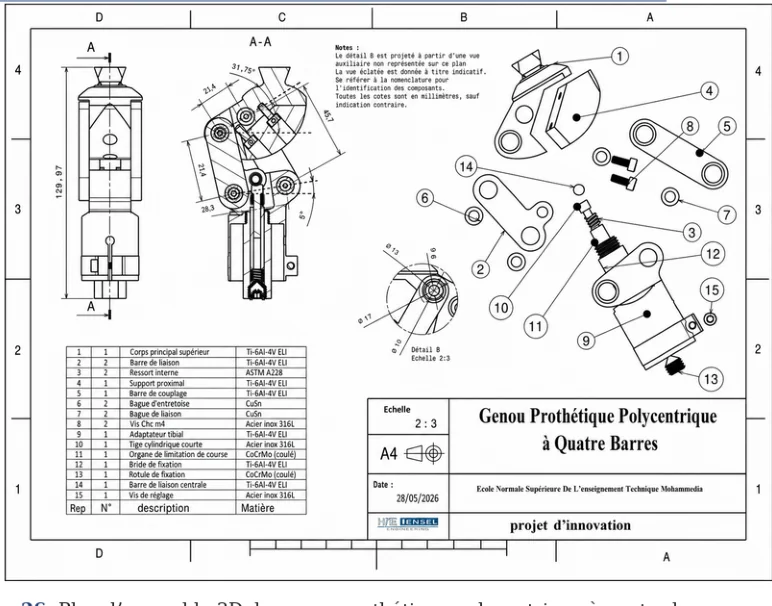
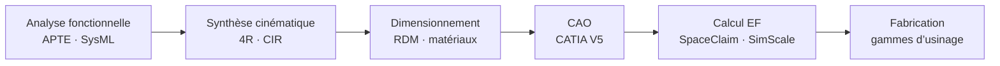
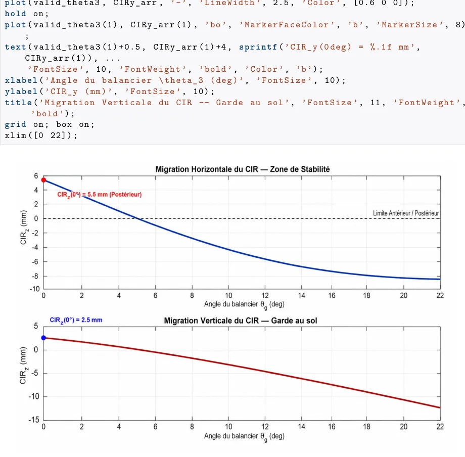
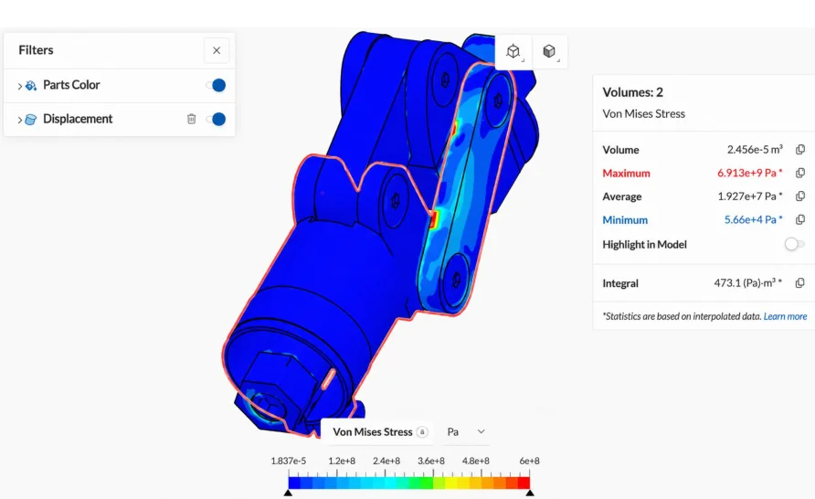

<div align="center">

# Conception d’un genou prothétique polycentrique

**Mécanisme à quatre barres · Du cahier des charges aux gammes d’usinage**

[](https://elmokhtarrayadi.github.io/conception-genou-polycentrique/)
[](https://elmokhtarrayadi.github.io/conception-genou-polycentrique/dossier-technique.html)

CATIA V5 · SpaceClaim · SimScale · SysML · Python / MATLAB · RDM



</div>

## Le problème

Un genou prothétique à axe unique oblige l’utilisateur à verrouiller activement sa jambe en appui. Un **mécanisme à quatre barres** déplace le centre de rotation pendant la flexion : en extension il reste en arrière de la ligne de charge (genou stable), puis migre vers l’avant pour faciliter la flexion. L’objectif était de concevoir un tel genou **léger, résistant et fabricable**.

## Résultats clés

| Indicateur | Résultat | Objectif |
| :-- | --: | :-- |
| Masse de l’assemblage CAO | **452 g** | ≤ 900 g ✅ |
| Contrainte max. sous 4 000 N (statique) | **360 MPa** | — |
| Facteur de sécurité statique | **≈ 2,44** | — |
| Déplacement maximal | **0,25 mm** | — |
| Facteur de sécurité en fatigue (2 200 N) | **≈ 1,30** | — |
| Migration du centre instantané de rotation | **21,7 mm** | Migration postéro-supérieure ✅ |

## Démarche



**1. Analyse fonctionnelle.** 7 fonctions de service avec critères mesurables (flexion ≥ 120°, masse, encombrement H ≤ 120 mm / Ø ≤ 80 mm, réglages, démontage ≤ 30 min), architecture SysML et prise en compte de l’ISO 10328.

**2. Cinématique.** Modélisation du quadrilatère articulé par fermeture de chaîne, calcul du CIR par le théorème de Kennedy, recherche des longueurs de barres par balayage de paramètres. Géométrie retenue : AB = 35,5 · BC = 21,4 · CD = 45,7 · AD = 28,3 mm.

<p align="center"></p>

**3. Dimensionnement et matériaux.** Corps et bielles en **Ti-6Al-4V ELI** (rapport résistance/masse), axes et visserie en **inox 316L**.

**4. Conception CATIA V5.** Support proximal, corps supérieur, barres de liaison et de couplage, adaptateur tibial, axes et bagues ; mise en plan et contrôle de masse.

**5. Calcul éléments finis.** Préparation du modèle sous SpaceClaim, maillage et calcul statique sous SimScale, puis estimation analytique en fatigue.

<p align="center"></p>

**6. Fabrication.** Définition des gammes d’usinage des pièces principales (bague, barre arrière, barre de couplage).

## Démo interactive

La [**démonstration en ligne**](https://elmokhtarrayadi.github.io/conception-genou-polycentrique/) permet de **manipuler le mécanisme 4 barres** et de voir le CIR se déplacer en temps réel, de parcourir la courbe du CIR, d’explorer la galerie des pièces et de consulter les cas de charge.
Le [**dossier technique**](https://elmokhtarrayadi.github.io/conception-genou-polycentrique/dossier-technique.html) détaille les équations, les tableaux de calcul, les cotations et les simulations (imprimable en PDF).

## Compétences mobilisées

Analyse fonctionnelle · Synthèse de mécanismes · RDM et fatigue · Choix de matériaux · CAO CATIA V5 · Simulation éléments finis · Préparation à la fabrication · Rédaction technique

## Limites et perspectives

Étude numérique : la suite naturelle est la **fabrication d’un prototype** et des **essais sur banc selon l’ISO 10328** (statique puis cyclique 3 millions de cycles). Côté modèle, il reste à affiner la cinématique au-delà de 110° de flexion (cible : 120°) et à documenter le passage de la grille d’optimisation aux cotes finales.

## Structure du dépôt

```text
├── index.html              # démonstration interactive
├── app.js / style.css      # logique et mise en page de la démo
├── dossier-technique.html  # dossier technique (6 chapitres, imprimable)
├── dossier-technique.css
└── assets/                 # captures CATIA, SpaceClaim, SimScale
```

---

<div align="center">

**Elmokhtar Rayadi** · Élève ingénieur en Génie Mécanique des Systèmes Industriels · [Tous mes projets](https://github.com/elmokhtarrayadi)

</div>
